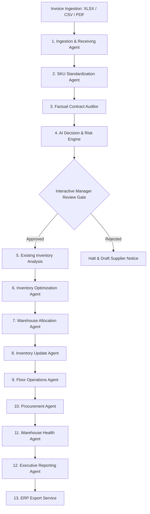

# 🧠 RetailPulse: Enterprise Autonomous Warehouse Control Room

> **An Autonomous 13-Agent AI Workforce Powered by Google Gemini & SQLite Source-of-Truth Architecture**

RetailPulse is an enterprise-grade autonomous warehouse operations center that transforms multi-format supplier invoice intake into a live, compute-driven decision and execution pipeline. Built around a NASA-inspired Control Room UI, RetailPulse deploys **13 specialized AI reasoning agents** working in concert to handle document extraction, catalog reconciliation, contract compliance auditing, automated risk scoring, 3D storage allocation, floor picker dispatch, replenishment purchasing, warehouse safety health tracking, executive reporting, and ERP integration.

---

## 🌟 Executive Summary & Key Features

- **🛸 Decentralized Control Room Architecture**: Every agent card dynamically renders an integrated header progress bar, live activity status, numeric metrics grid, color-coded rolling mission log (last 20 logs with 🟢 Success, 🟡 Warning, 🔴 Error, 🔵 Info), and interactive workplace data grids.
- **⚡ Compute-Driven Real-Time Streaming**: Zero hardcoded artificial delays. Every event and table row rendered on the dashboard is yielded directly during active runtime database queries, fuzzy string matching, and LLM reasoning cycles.
- **🛡️ Two-Phase Human-in-the-Loop Override Gate**: Halts execution post-audit to render a before-and-after inventory projection matrix, allowing warehouse operations managers to review violations and either **Approve** or **Reject** the shipment.
- **📂 Multi-Format Ingestion Engine**: Seamlessly processes Excel (`.xlsx`), CSV (`.csv`), and PDF (`.pdf`) invoices.
- **📑 Full Suite of Automated Deliverables**:
  - `master_inventory.xlsx`: Master active inventory workbook generated directly from SQLite.
  - `worker_tasks.pdf`: Dispatched shelf loading routes with rack/bin coordinates formatted for floor staff.
  - `manager_summary.pdf`: Executive report with supplier scorecards and compliance summaries.
  - `erp_export.json`: Serialized transaction log formatted for ERP system synchronization.
  - `purchase_order.docx`: Replenishment PO document for safety stock reorders.
  - `supplier_dispute_email.txt`: Drafted email detailing pricing contract infractions.
  - `supplier_notice.txt`: Formal rejection notice for expired or unmapped catalog items.

---

## 🏗️ System Architecture & Workflow



---

# 🤖 13 AUTONOMOUS WORKFORCE AGENTS (COMPREHENSIVE BREAKDOWN)

Each agent in RetailPulse is a specialized reasoning module operating on distinct inputs, models, and business constraints. Below is the complete technical specification of every agent in the workforce:

---

## 1. 📥 Ingestion & Receiving Agent

### Overview
The Receiving Agent is the front-line ingestion worker responsible for loading raw supplier invoice files, determining document formats, extracting line items, and normalizing raw invoice metadata.

- **Model Used**: `Gemini 1.5 Flash` (High-speed document parsing)
- **Execution Mode**: Pre-Approval Ingestion
- **Input Data**: Raw file path (`.xlsx`, `.csv`, or `.pdf`), supplier name, and file extension.
- **Output Data**: `RawInventory` (contains supplier name, list of extracted raw line items: description, cost, quantity, expiry date).

### Operational Workflow
1. Detects file format (Excel via `pandas`, CSV via `pandas`, or PDF via text/vision extraction).
2. Parses line-by-line billing data and normalizes date strings into ISO format (`YYYY-MM-DD`).
3. Passes raw text to Gemini Flash to extract JSON structures conforming to `RawInventory`.
4. Streams dynamic `AgentStep` updates item-by-item displaying extracted line descriptions, raw costs, and quantities.

---

## 2. 🧠 SKU Standardization Agent

### Overview
The SKU Standardization Agent reconciles raw supplier product descriptions against the warehouse's SQLite master catalog (`products` table) using fuzzy string matching and LLM candidate search.

- **Model Used**: `Gemini 1.5 Flash`
- **Execution Mode**: Pre-Approval Ingestion
- **Input Data**: `RawInventory` line items.
- **Output Data**: `StandardizedInventory` (list of mapped items with catalog SKU, matched product name, confidence percentage, unit price, quantity, and expiry date).

### Operational Workflow
1. Checks the internal SKU lookup cache for existing matches to reduce API latency.
2. Performs fuzzy ratio scoring against active catalog product names.
3. If fuzzy score < 85%, queries Gemini Flash with candidate options to identify the correct SKU.
4. If no candidate matches, flags the item as `UNKNOWN_PRODUCT` with `0.0%` confidence.
5. Streams item-by-item table rows containing `Raw Description`, `Matched SKU`, `Product Name`, and `Confidence %`.

---

## 3. 🔎 Factual Contract Auditor

### Overview
The Auditor Agent evaluates standardized line items against active vendor pricing contracts and warehouse safety rules to identify compliance violations.

- **Model Used**: `Gemini 1.5 Flash`
- **Execution Mode**: Pre-Approval Ingestion
- **Input Data**: `StandardizedInventory` and SQLite catalog contract pricing rules.
- **Output Data**: `AuditReport` (total billed amount, list of `ViolationDetail` entries: `PRICE_VIOLATION`, `EXPIRY_VIOLATION`, `DUPLICATE_ENTRY`, `UNKNOWN_PRODUCT`).

### Audit Rules Enforced
- **Price Audit**: Compares billed cost against contract `unit_price`. Flags overcharges exceeding tolerance.
- **Freshness Audit**: Rejects items expiring within **7 days** of receipt date.
- **Duplicate Audit**: Detects duplicate SKU entries within the same invoice shipment.
- **Catalog Audit**: Identifies items not present in the master catalog.
- Streams live compliance check logs (🟢 Passed / 🔴 Violation) for each line item.

---

## 4. ⚖ AI Decision & Risk Engine

### Overview
The Decision Agent synthesizes audit findings, calculates an overall shipment risk score (0.0 to 10.0), and formulates an initial operational disposition recommendation.

- **Model Used**: `Gemini 1.5 Pro` (Complex reasoning and risk modeling)
- **Execution Mode**: Pre-Approval Ingestion (Halts execution at `WAITING_APPROVAL`)
- **Input Data**: `RawInventory`, `StandardizedInventory`, and `AuditReport`.
- **Output Data**: `DecisionReport` (`disposition`: `ACCEPT`, `REJECT`, `PARTIAL_ACCEPT`, `HUMAN_REVIEW`; `risk_score`; `reasoning`; lists of `items_accepted` and `items_rejected`).

### Risk Scoring Formula
- `Base Score`: 0.0
- `Price Overcharge`: +2.5 per infraction
- `Near-Expiry Batch`: +3.5 per infraction
- `Duplicate Entry`: +1.5 per infraction
- `Unknown Product`: +2.0 per infraction
- Pauses the execution flow and displays the **Interactive Operations Manager Review Panel** in the UI.

---

## 5. 🔍 Existing Inventory Analysis Agent

### Overview
Operating immediately post-manager approval, the Inventory Analysis Agent audits existing SQLite stock levels and evaluates current warehouse location capacity utilization.

- **Model Used**: `Gemini 1.5 Flash`
- **Execution Mode**: Post-Approval Operations
- **Input Data**: Approved shipment transaction ID.
- **Output Data**: `dict` containing current warehouse stock layout, total active inventory count, and existing location utilization percentages.

### Operational Workflow
1. Queries SQLite `inventory` and `warehouse_locations` tables.
2. Calculates existing stock balances for each incoming accepted SKU.
3. Identifies storage zone occupancy rates (Dry Storage vs Cold Storage).
4. Streams current stock levels and capacity availability metrics to the dashboard.

---

## 6. 🧠 Inventory Optimization Agent

### Overview
The Optimization Agent formulates stock rotation strategies and applies FEFO (First-Expired, First-Out) inventory rules to prevent spoilage and balance bin workloads.

- **Model Used**: `Gemini 1.5 Pro`
- **Execution Mode**: Post-Approval Operations
- **Input Data**: Existing stock balances, incoming batch expiry dates, and product categories.
- **Output Data**: `dict` containing optimized rotation strategy recommendations, markdown alerts, and bin allocation rules.

### Strategy Rules
- **Dairy / Perishables**: Requires Cold Storage allocation (`Zone C`). Enforces strict FEFO picking queues.
- **Grains / Pulses**: Requires Dry Storage allocation (`Zone A/B`). Evaluates moisture and reorder thresholds.
- **Markdown Alerts**: Flags existing batches expiring within 14 days for immediate retail price markdown.

---

## 7. 📦 Warehouse Allocation Agent

### Overview
The Allocation Agent solves 3D coordinate placement across warehouse racks, shelves, and bins, assigning physical coordinates to every accepted item batch.

- **Model Used**: `Gemini 1.5 Flash`
- **Execution Mode**: Post-Approval Operations
- **Input Data**: Accepted item quantities, product categories, and `warehouse_locations` availability.
- **Output Data**: `dict` containing assigned physical coordinates (`rack`, `shelf`, `bin`, `zone`) for every accepted item.

### Allocation Rules
- **Dry Zone (Racks A1–B4)**: Assigned for Grains, Beverages, and Dry Grocery items.
- **Cold Zone (Racks C1–C2)**: Assigned for Dairy and Perishable items.
- Streams live coordinate searches (e.g. `Evaluating Rack A1... Full -> Evaluating Rack B2... Space Available -> Allocated`).

---

## 8. ⚙️ Inventory Update Agent

### Overview
The Inventory Update Agent acquires write locks on the SQLite database, executes transactional inserts, updates active inventory balances, and calculates inventory valuation deltas.

- **Model Used**: Pure Python & SQLite Engine
- **Execution Mode**: Post-Approval Operations
- **Input Data**: Transaction ID, supplier name, accepted items, and allocated physical coordinates.
- **Output Data**: `dict` containing database write logs, inserted batch numbers, and updated total inventory valuation ($).

### Operational Workflow
1. Generates unique batch tracking IDs (`BATCH_XXXXXX`).
2. Inserts new rows into the SQLite `inventory` table with status `'ACTIVE'`.
3. Updates `warehouse_locations` occupied capacity counters.
4. Computes net warehouse inventory value increase ($).
5. Streams database commit confirmations line-by-line.

---

## 9. 📦 Floor Operations Agent

### Overview
The Floor Agent translates assigned storage coordinates into optimized routing tasks for warehouse pickers and forklift drivers, exporting `worker_tasks.pdf`.

- **Model Used**: `Gemini 1.5 Flash`
- **Execution Mode**: Post-Approval Operations
- **Input Data**: Transaction ID, supplier name, and physical slot allocations.
- **Output Data**: `WorkerTasks` (PDF file path `outputs/worker_tasks.pdf`, total task count, list of `WorkerTaskItem` routes).

### Operational Workflow
1. Sorts tasks by warehouse zone and rack proximity to minimize worker travel distance.
2. Compiles printable task sheets using ReportLab PDF generation.
3. Displays a shelf loading visualizer on the manager control panel.
4. Streams task assignment logs to the agent card data grid.

---

## 10. 🧾 Procurement Agent

### Overview
The Procurement Agent evaluates post-intake warehouse safety stock levels, identifies reorder warnings, and drafts replenishment Purchase Orders (PO), dispute emails, and rejection notices.

- **Model Used**: `Gemini 1.5 Pro`
- **Execution Mode**: Post-Approval Operations
- **Input Data**: Transaction ID, supplier name, accepted items, and audit violation reports.
- **Output Data**: `PurchaseDocuments` (`po_path`, `dispute_email_path`, `notice_path`).

### Automated Document Generation
- **Replenishment PO (`purchase_order.docx`)**: Generated via `python-docx` if accepted stocks drop below minimum safety reorder thresholds (e.g. < 80 units for grains, < 50 units for dairy). Inserts draft PO rows into SQLite `purchase_orders`.
- **Pricing Dispute Email (`supplier_dispute_email.txt`)**: Drafted automatically if contract price overcharges were identified during audit.
- **Supplier Rejection Notice (`supplier_notice.txt`)**: Drafted automatically if items were rejected due to expiry or catalog infractions.

---

## 11. 📊 Warehouse Health Agent

### Overview
The Warehouse Health Agent conducts a post-update audit of global warehouse operations, calculating capacity utilization percentages, stock fresh metrics, and active risk alerts.

- **Model Used**: `Gemini 1.5 Flash`
- **Execution Mode**: Post-Approval Operations
- **Input Data**: Transaction ID.
- **Output Data**: `dict` (`utilization_pct`, `near_expiry_count`, list of `reorder_alerts`).

### Metrics Calculated
- **Global Occupancy Rate**: `(Total Occupied Bins / Total Warehouse Capacity) * 100`.
- **Near-Expiry Inventory**: Total active inventory items expiring within 7 days.
- **Reorder Warning Flags**: Total SKUs operating below minimum safety stock levels.

---

## 12. 👔 Executive Reporting Agent

### Overview
The Executive Reporting Agent synthesizes the entire operational intake flow, computes a supplier compliance scorecard (0.0 to 100.0), writes an executive summary, and exports `manager_summary.pdf`.

- **Model Used**: `Gemini 1.5 Pro`
- **Execution Mode**: Post-Approval Operations
- **Input Data**: Transaction ID, supplier name, accepted/rejected totals, inventory value, and audit violations.
- **Output Data**: `ManagerSummary` (`pdf_path`, `accepted_items_count`, `rejected_items_count`, `total_value`, `supplier_score`, `executive_summary`).

### Scorecard Formula
- `Base Score`: 100.0
- `Deductions`: -15.0 per price violation, -20.0 per expiry violation, -10.0 per duplicate entry, -25.0 per unknown product.
- Exports printable PDF executive report containing scorecards, item breakdowns, and AI recommendations.

---

## 13. 🔌 ERP Export Service

### Overview
The ERP Export Agent serializes the complete transaction hierarchy into a standardized JSON payload (`outputs/erp_export.json`) ready for synchronization with external ERP systems (SAP, Oracle, NetSuite).

- **Model Used**: Pure Python Engine (Zero LLM overhead)
- **Execution Mode**: Post-Approval Operations
- **Input Data**: Transaction ID, supplier name, and committed inventory database records.
- **Output Data**: `dict` JSON payload containing transaction metadata, batch numbers, physical coordinates, and status flags.

### Payload Structure
```json
{
  "transaction_id": "RP-2026-F98522",
  "supplier_name": "Jaxnation",
  "timestamp": "2026-07-30 10:15:00",
  "total_items_processed": 4,
  "items": [
    {
      "sku": "SKU_29_205_1132",
      "quantity": 50,
      "rack": "A1",
      "shelf": "2",
      "expiry_date": "2026-10-28",
      "batch_number": "BATCH_904F12",
      "status": "ACTIVE",
      "zone": "Dry Storage",
      "category": "Grains"
    }
  ]
}
```

---

## 💻 Tech Stack & Tools

- **Core Framework**: Python 3.10+
- **Frontend / Control Room**: Streamlit (Glassmorphism NASA Theme with native containers)
- **AI / LLM Engine**: Google Gemini API (`google-genai` / `google.generativeai` — Gemini 1.5 Pro & Flash)
- **Database**: SQLite 3 (`database/retailpulse.db`)
- **Data Manipulation**: `pandas`, `openpyxl`
- **Document Generation**: `reportlab` (PDF generation), `python-docx` (Word PO generation)
- **Data Validation**: Pydantic v2 (`BaseModel`, `@field_validator`)

---

## 🛠️ Installation & Setup Guide

### 1. Prerequisites
- Python 3.10 or higher installed
- Google Gemini API Key

### 2. Clone Repository & Install Dependencies
```bash
git clone https://github.com/Dhaarani1116/RetailPulse.git
cd RetailPulse

# Create and activate virtual environment
python -m venv venv
source venv/bin/activate  # On Windows: venv\Scripts\activate

# Install required packages
pip install -r requirements.txt
```

### 3. Environment Configuration
Create a `.env` file in the root directory:
```env
GEMINI_API_KEY="your_google_gemini_api_key_here"
```

### 4. Seed SQLite Master Database
```bash
python -c "from src.database.sqlite import seed_database; seed_database()"
```

---

## 🚀 Running the Platform

### Launch the Streamlit Control Room
```bash
streamlit run app.py
```
Navigate to **`http://localhost:8501`** in your browser.

### Run Automated Pipeline Test Suite
```bash
python test_pipeline.py
```

---

## 📄 License

This project is licensed under the MIT License - see the `LICENSE` file for details.
